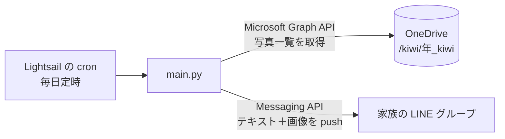

# OneDrive 思い出写真 LINE bot

OneDrive に年別で保存している犬（キウイ）の写真から、**毎日決まった時刻に「今と同じ季節に撮った 1 枚」をランダムに選び、家族の LINE グループに投稿する** bot です。

写真の取捨選択はせず、当たり外れも込みで毎日楽しむ、という考え方で作りました。現在は運用を停止しています（下の「停止した理由」を参照）。

## しくみ



1. AWS Lightsail（Ubuntu）の cron が毎日決まった時刻に `main.py` を起動する
2. Microsoft のログイン（MSAL）で OneDrive の読み取り用トークンを取得する（初回だけデバイスコードでログインし、以降は `token_cache.bin` のキャッシュを使う）
3. 対象フォルダ（`/kiwi/2022_kiwi` など）をランダムな順に見て、**今月とその前後 1 か月**に撮った写真を探す
   - 撮影日はファイル名の先頭の `YYYYMMDD_`（または `YYYYMMDD-`）から読み取る
   - 対象の拡張子は `.jpg` / `.jpeg` / `.heic`
4. 見つかった中から 1 枚をランダムに選び、OneDrive の一時ダウンロード URL を使って「📸 2023/10/12 頃の思い出」というテキストと画像を LINE グループに送る

## ファイル構成

```
.
├── main.py              本体（写真を選んで LINE に投稿）
├── sub.py               検証用: フォルダごとの画像数と、ダウンロード URL が取れるかを確認する
├── gemini_text_test.py  実験用: Gemini API で写真のタイトルを作れるか試したスクリプト（本体では未使用）
├── requirements.txt     Python パッケージ一覧
├── .env.example         設定値のひな形（これを .env にコピーして使う）
├── .gitignore           .env・鍵ファイル・トークンキャッシュを Git に含めない設定
└── docs/作業メモ.md      Lightsail での運用手順のメモ
```

## 必要なもの

- Python 3
- **Microsoft のアプリ登録**（Azure ポータル →「アプリの登録」）
  - サポートされるアカウントの種類に「個人用 Microsoft アカウント」を含める
  - 「パブリック クライアント フローを許可する」を有効にする（デバイスコードでのログインに必要）
  - API のアクセス許可に Microsoft Graph の `Files.Read`（委任）を追加する
- **LINE Messaging API のチャネル**（LINE Developers）
  - チャネルアクセストークン（長期）を発行する
  - bot を家族のグループに招待し、そのグループ ID を控える
- 実行環境（当時は AWS Lightsail の Ubuntu。cron が動けばどこでも可）

## セットアップ

```bash
python3 -m venv venv
source venv/bin/activate
pip install -r requirements.txt

cp .env.example .env   # .env に CLIENT_ID・LINE_CHANNEL_TOKEN・LINE_GROUP_ID を記入
python main.py         # 初回は表示される URL とコードで Microsoft にログイン
```

対象フォルダは `main.py` の `PHOTO_FOLDERS` で変更します。

`gemini_text_test.py` を試す場合は、別途 `pip install google-generativeai` と `.env` の `GEMINI_API_KEY` が必要です。

### 設定値（.env）

| 名前 | 内容 |
|---|---|
| `CLIENT_ID` | Microsoft のアプリ登録のクライアント ID |
| `TENANT_ID` | 個人アカウントなら `consumers`（既定値） |
| `SCOPES` | `Files.Read`（既定値） |
| `GRAPH_ENDPOINT` | `https://graph.microsoft.com/v1.0`（既定値） |
| `LINE_CHANNEL_TOKEN` | LINE のチャネルアクセストークン |
| `LINE_GROUP_ID` | 投稿先の LINE グループ ID |
| `GEMINI_API_KEY` | `gemini_text_test.py` だけで使用 |

### 毎日定時に動かす（cron）

`crontab -e` で、たとえば毎朝 8 時（サーバーの時刻設定に注意）に実行します。

```cron
0 8 * * * cd /home/ubuntu/onedrive_line_bot && ./venv/bin/python main.py >> bot.log 2>&1
```

サーバーへのファイルの送り方などは [docs/作業メモ.md](docs/作業メモ.md) を参照してください。

## 秘匿情報の扱い

このリポジトリには、トークン・鍵・パスワードは含めていません。当時の作業フォルダにあった次のファイルは**アップロードしていません**。

| ファイル | 中身 | 対応 |
|---|---|---|
| `.env` | Microsoft・LINE・Gemini の設定とキー | 除外。代わりに値を空にした `.env.example` を追加 |
| `LightsailDefaultKey-ap-northeast-1.pem` | Lightsail に SSH で入るための秘密鍵 | 除外 |
| `LINEアクセストークン` | LINE のチャネルアクセストークンのメモ | 除外 |
| `token_cache.bin` | Microsoft ログインのトークンキャッシュ | 除外 |

また、作業メモに書かれていたサーバーの IP アドレスと手元の鍵ファイルのパスは伏せ字にしました。コード（`.py`）はもともとすべての値を `.env` から読む作りで、直接書かれたキーはありませんでした。これらのファイルは `.gitignore` でも除外しています。

## 停止した理由と反省点

- 無料枠の範囲で動いていたが、**AWS（Lightsail）と Microsoft（Azure / OneDrive）の 2 社のコストを別々に管理するのが手間**だった
- 写真が増えると OneDrive の容量が足りなくなり、大容量プランはやや割高
- そのほか気づいた点
  - OneDrive の一時ダウンロード URL をそのまま LINE に渡しているため、時間がたつと画像が開けなくなる可能性がある
  - プレビュー画像にも元画像の URL を使っているので、サイズが大きいと LINE 側で表示されないことがある
  - `.heic` は LINE が対応していない形式のため、選ばれると表示できない
  - 撮影日をファイル名から読むので、命名ルールが違う写真は対象外になる
